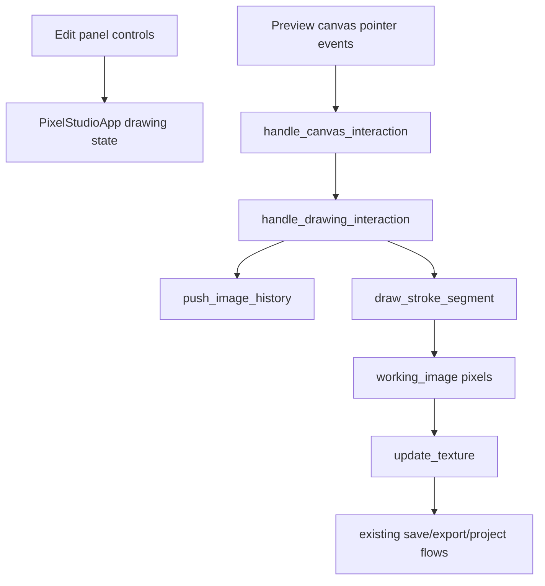

## Plan: drawing tools
**Goal:** Add basic canvas drawing tools so users can draw freehand strokes and straight lines directly on the loaded image.
**Complexity:** L3

### Functional Specification
- Add drawing controls in the Edit panel for tool mode, color, brush size, and opacity.
- Support freehand brush strokes by dragging on the preview image.
- Support straight line strokes by dragging from start to end on the preview image.
- Show a non-destructive straight-line preview while dragging, then commit pixels on mouse release.
- Integrate drawing with the existing image undo/redo stack and texture refresh pipeline.
- Keep existing selection, layer dragging, pan, save, export, and project behavior intact.

### Function Inventory
1. [new function] `draw_tools_panel` -> file: `crates/studio-app/src/app.rs` -> renders drawing controls.
2. [new function] `handle_drawing_interaction` -> file: `crates/studio-app/src/app.rs` -> routes pointer events for brush and line tools.
3. [new function] `begin_drawing_stroke` -> file: `crates/studio-app/src/app.rs` -> snapshots undo state and records drag start.
4. [new function] `continue_drawing_stroke` -> file: `crates/studio-app/src/app.rs` -> commits brush segments while dragging.
5. [new function] `finish_drawing_stroke` -> file: `crates/studio-app/src/app.rs` -> commits the final straight line and clears transient state.
6. [new function] `paint_drawing_preview` -> file: `crates/studio-app/src/app.rs` -> paints line preview overlay.
7. [new function] `draw_stroke_segment` -> file: `crates/studio-app/src/app.rs` -> rasterizes a thick anti-gap stroke segment into `DynamicImage`.
8. [new function] `blend_brush_pixel` -> file: `crates/studio-app/src/app.rs` -> alpha-blends brush color over one pixel.
9. [new enum] `DrawTool` -> file: `crates/studio-app/src/app.rs` -> `Brush` and `Line`.
10. [existing function] `edit_panel` -> file: `crates/studio-app/src/app.rs` -> calls `draw_tools_panel`.
11. [existing function] `handle_canvas_interaction` -> file: `crates/studio-app/src/app.rs` -> delegates to drawing mode before selection/layer behavior.
12. [existing function] `push_image_history` -> file: `crates/studio-app/src/app.rs` -> reused for undo snapshot.
13. [existing enum] `TextKey` -> file: `crates/studio-app/src/i18n.rs` -> adds drawing labels in zh-TW and English.

### Architecture

### Risks
| Risk | Mitigation |
|------|------------|
| Drawing conflicts with selection/layer dragging | Only enable drawing when drawing mode is active; select/pan remain unchanged otherwise. |
| Undo snapshots pushed too often | Push once at stroke start, then mutate during drag until release. |
| Fast pointer movement leaves gaps | Rasterize interpolated circles along the segment path. |
| Straight line lacks visual feedback | Draw an egui overlay preview before committing pixels. |

### Definition of Done
- [x] Edit panel has drawing controls with Traditional Chinese and English labels.
- [x] Brush tool draws continuous strokes on the loaded image.
- [x] Line tool previews while dragging and commits on release.
- [x] Undo/redo works for each completed drawing stroke.
- [x] `cargo fmt --check` passes.
- [x] `cargo clippy --workspace --all-targets -- -D warnings` passes.
- [x] `cargo test --workspace` passes.

### Assumptions
- Drawing should modify the background image directly, not create separate vector layers.
- First milestone covers brush and straight line; shapes/textured brushes can be added later.
- Project save/open continues to work because the background PNG already stores `working_image`.
