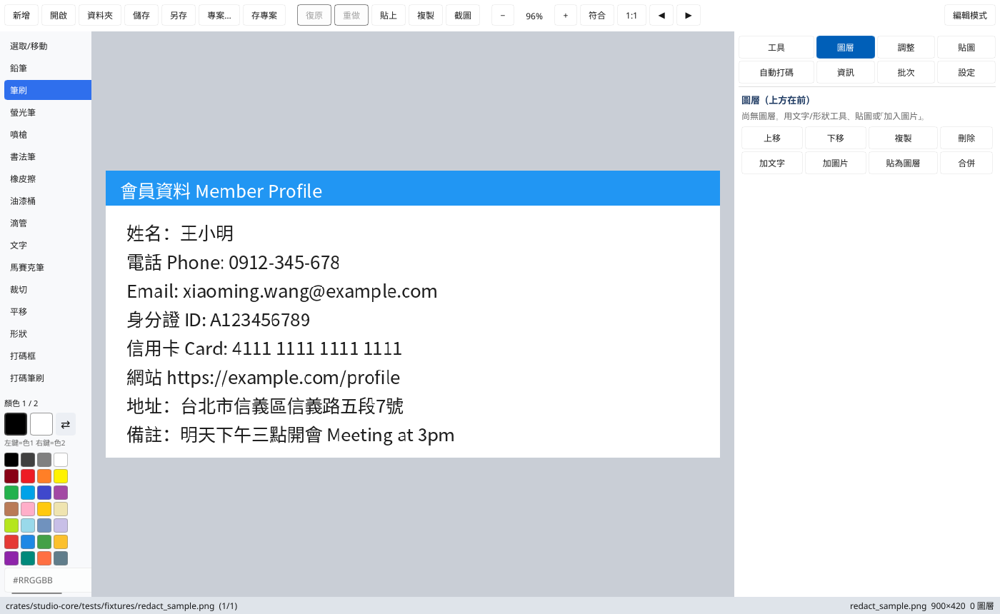
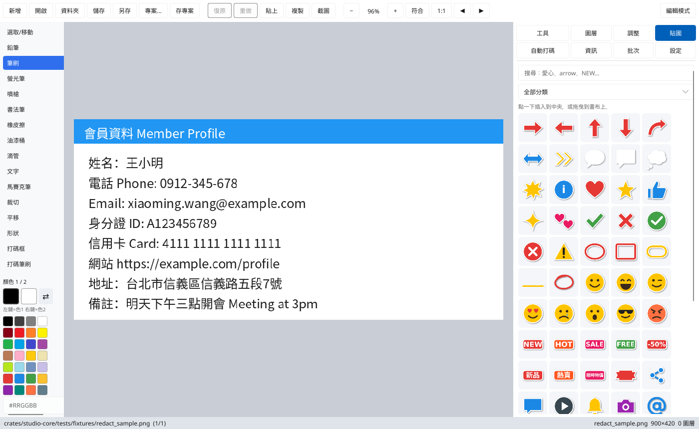
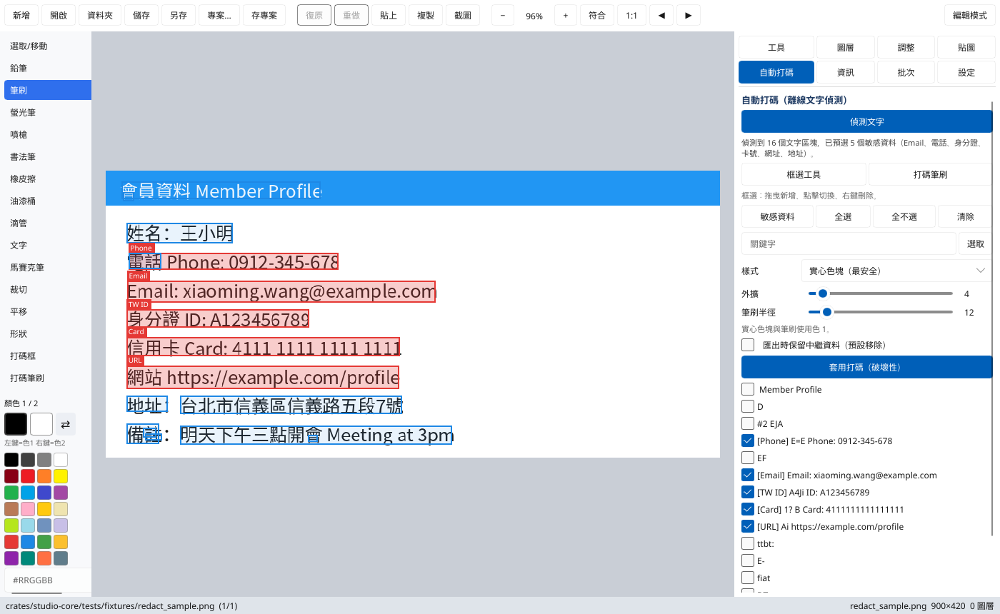
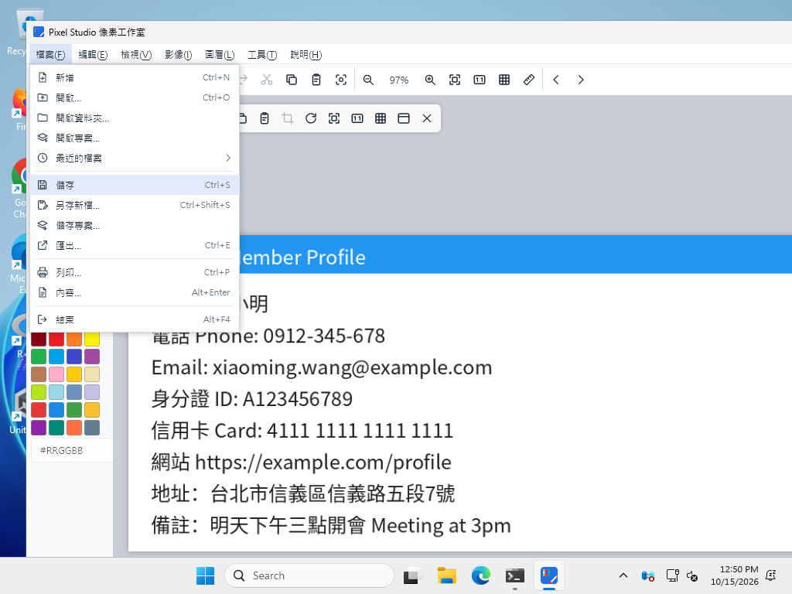
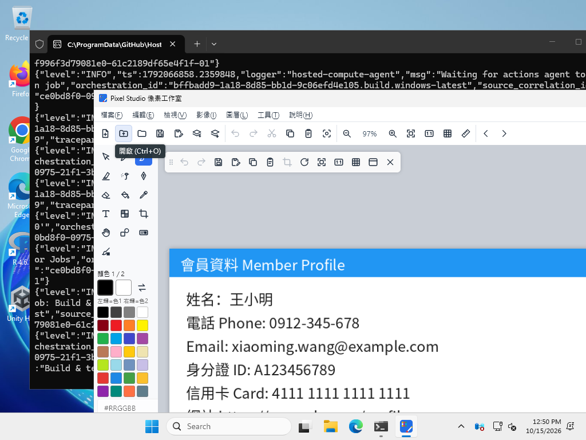
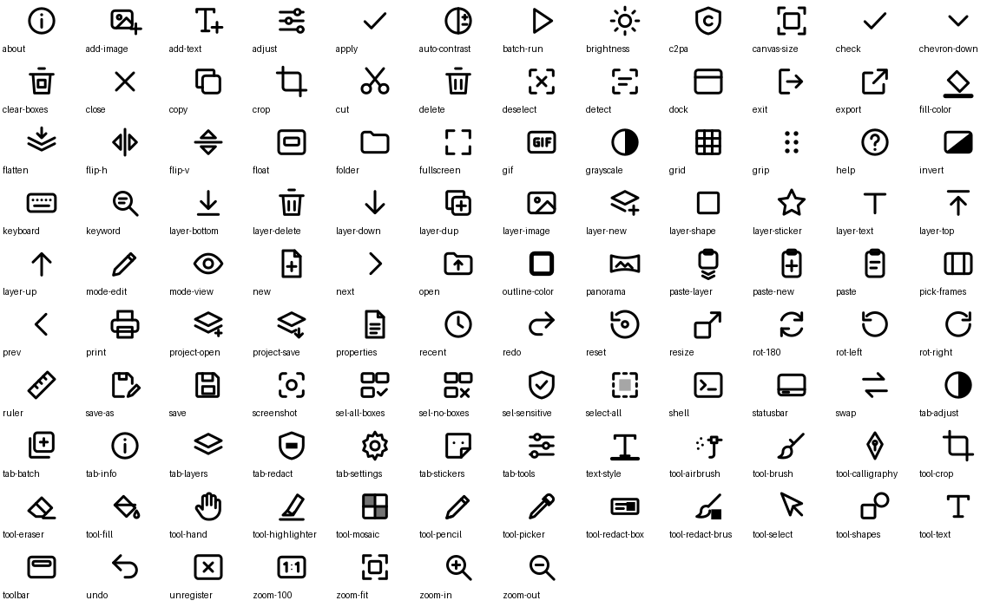
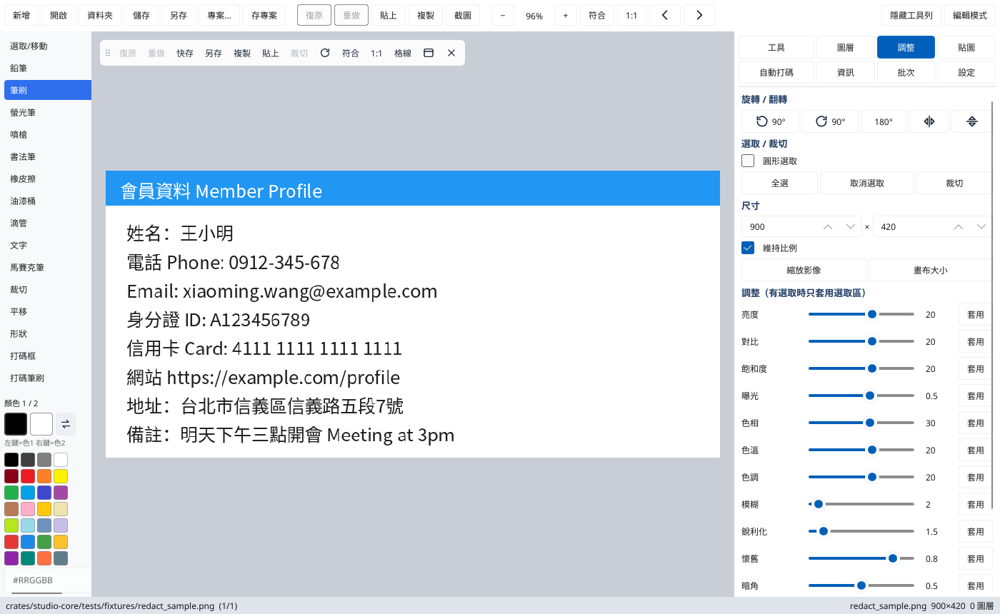
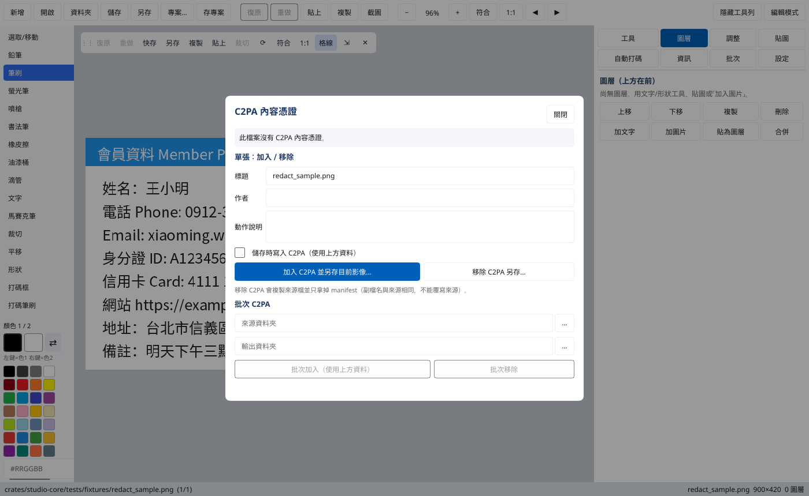

# Pixel Studio

English ｜ [繁體中文](README.md)

A Rust + [Slint](https://slint.dev) image editor that aims to **replace and surpass MS Paint**: painting, layers, stickers, social-media post images, offline auto-redaction and batch conversion, on Windows, Linux and macOS.

Downloads: [Releases](https://github.com/stevenke1981/pixel-studio/releases)
- Windows: `pixel-studio-setup-windows-x64.exe` (installer) or `pixel-studio-windows-x64.zip` (portable)
- Linux: `pixel-studio-linux-x64.tar.gz`
- macOS (Intel + Apple silicon): `pixel-studio-macos-universal-app.zip`





## v0.4.0: icon buttons, menu bar, Windows CJK font, smaller binaries

- **All function buttons are now SVG icons** (top bar, tool palette, floating toolbar, Adjust, Layers, Stickers, Redact, Batch). Hovering shows the name and shortcut. Buttons have hover, pressed, disabled and active states, plus screen-reader labels. The icon set is original (`scripts/gen-icons.py`, 115 icons).
- **Windows-style menu bar**: File, Edit, View, Image, Layer, Tools, Help. Open a menu with Alt+letter, move with the arrow keys, run with Enter, close with Esc; shortcuts are shown in the menus. It includes recent files, print, properties, cut/delete, rulers, status bar, full screen, an image/canvas size dialog, a shortcuts list (F1) and About.
- **New shortcuts**: single-key tools (S P B L A K E F I T M C H U R, Shift+R), X to swap colours, Ctrl+X/E/P/R/W/J/]/[, F11.
- **Windows CJK font**: the UI font is set to Microsoft JhengHei UI, falling back to YaHei UI, PMingLiU, then SimSun. Characters like 啟 now display correctly.
- **Binary size**: Linux pixel-studio went from 80.5 MB to 33.7 MB, and studio-cli from 45.0 MB to 17.7 MB.





## v0.3.1: quick toolbar, C2PA dialog, timestamped names

- **Floating quick toolbar**: undo, redo, quick save (Ctrl+S; asks for format/quality only the first time, then overwrites), save as, copy, paste, crop to selection, rotate, fit / 100%, grid (Ctrl+G). Drag the grip to move it; dock or hide it (top bar "Show/Hide toolbar"). Its position is remembered. Tooltips list the shortcuts, and buttons are disabled when unavailable.
- **Canvas context menu**: right-click with the Select, Crop, Text or Shapes tool for undo/redo, copy/paste, select all, crop, delete layer, rotate, zoom, grid and save.
- **C2PA content credentials dialog** (Info tab → "C2PA content credentials…"): shows validation state, manifest count, title/creator/action and the raw JSON. You can add credentials and save a copy of the current image, write C2PA on save, or strip C2PA to a copy (same extension; the source is never overwritten). Batch add/remove shows progress and results. When you open a file, the fields are pre-filled from its manifest (or the filename is used as the title).
- **Default filenames**: Save, Save As, export, screenshot and paste-as-new default to `pixelstudio_YYYYMMDD_HHMMSS.<ext>` in local time, and you can still edit the name. The CLI `convert/redact/crop/blur-region/pano360` output argument is now optional and uses the same pattern.
- Redaction boxes can be dragged to move them and resized from the bottom-right corner. With the Select tool, drag the canvas right, bottom or corner handle to resize the canvas.




## v0.3.0: Slint UI

- The GUI moved from egui to Slint. Windows uses the Skia renderer (the software renderer's partial redraw left transparent areas on some systems) and falls back to the software renderer if Skia cannot start.
- The canvas is a pixel buffer; brush strokes recomposite only the dirty rectangle, and layers are re-rendered only when they change.
- Document logic (painting, layers, undo, stickers, redaction, project files) lives in a UI-independent, unit-tested `doc.rs`.
- Shortcuts: Ctrl+O/S/Z/Y/V/C/A/D/G, Ctrl+Shift+V paste as layer, Del delete layer, arrows nudge a layer (Shift ×10), Enter crop, Esc cancel, +/-/0/1 zoom, Ctrl+wheel zoom, middle-drag or the Pan tool to pan; drop image files onto the window to open them.

## Compared with Paint

| Feature | Paint | Pixel Studio |
|---|---|---|
| Pencil, brush, eraser, fill, colour picker, text | ✓ | ✓ (plus highlighter, airbrush, calligraphy, mosaic) |
| Shapes: line, arrow, rectangle, ellipse, triangle | ✓ | ✓ (colour 1 outline, optional colour 2 fill; shapes stay editable layers) |
| Select, crop, resize, rotate, flip | ✓ | ✓ (rectangle/circle selection, crop to selection, resize image and canvas size) |
| Zoom, undo/redo | ✓ | ✓ (crisp pixels when zoomed + pixel grid, Ctrl+G) |
| Layers, transparency | partial | ✓ text / image / shape / sticker layers: move, reorder, hide, opacity |
| Brightness, contrast, saturation, hue, blur, sharpen | ✗ | ✓ plus exposure, temperature, tint, sepia, vignette, posterize, auto contrast, grayscale, invert |
| Sticker library (arrows, callouts, hearts/stars, checks/crosses, numbers, highlight boxes, emoji, NEW/HOT/SALE labels, generic social icons) | ✗ | ✓ 65 original SVGs: search, click or drag to insert, resize, recolour, outline, shadow |
| Social canvas presets | ✗ | ✓ IG post 1080×1080, IG portrait 1080×1350, IG story 1080×1920, FB 1200×630, X 1600×900, YouTube thumbnail 1280×720, LINE 1040×1040 |
| Quick text styles (outlined / shadowed titles) | ✗ | ✓ |
| Auto redaction | ✗ | ✓ offline text detection, pre-selects phones, emails, TW IDs, cards, URLs, addresses |
| Paste clipboard as a new image, screenshots | partial | ✓ |
| Formats | PNG/JPEG/BMP/GIF/TIFF/HEIC | PNG, JPEG, BMP, GIF, ICO, WebP (lossless + lossy with quality), TIFF |
| Batch convert, animated GIF, 360° panorama, C2PA | ✗ | ✓ |
| Right-click menu, Open With | built in | ✓ "Edit / Open with Pixel Studio", never hijacks your default app |

## Auto Redact (Redact tab)

1. Click **Detect text**. Text is detected locally with the [ocrs](https://github.com/robertknight/ocrs) models (bundled in the installer and archives, ~12 MB; downloaded once on first use when running from source).
2. Boxes are drawn over the image. Lines recognised as phone numbers (TW + international), emails, Taiwan national IDs (checksum), credit cards (Luhn), URLs or addresses are pre-selected (red).
3. With the Redact boxes tool, click a box or its list label to select it (orange outline). Delete/Backspace, right-click or its row delete button removes only that box; Ctrl+Z undoes and Ctrl+Y redoes. Drag empty space to add a manual box. List checkboxes and keyword selection control which boxes are applied, independently of the orange editing selection. Delete does not remove boxes while editing text or while a dialog is open.
4. Pick a style: **solid box (default, any colour)**, mosaic or blur, plus padding. Mosaic and blur can sometimes be partially reversed; use a solid box for secrets.
5. Applying flattens layers into the pixels (destructive). Exports strip EXIF/XMP by default; tick "Keep EXIF/ICC metadata" in the Tools or Redact tab to keep it.
6. Manual **Boxes** and **Redact brush** tools are included.

Boxes are previews and are not saved in project files; apply them before saving the output. Deleting a preview box does not remove redaction already applied to image pixels.

**Limitation:** detection is script-agnostic, so Chinese and English lines are both boxed, but *recognition* currently reads Latin letters, digits and symbols only. Chinese-only content (for example a Chinese street address) is not auto-selected and must be clicked manually.

CLI: `studio-cli redact in.png out.png [--style solid|mosaic|blur] [--keyword WORD] [--all] [--keep-metadata]`

## Shell menu and file associations

- Installer tasks: right-click menu, add to "Open with" (on by default, keeps your default app), make default for PNG/WebP (off by default), desktop icon.
- Portable: `pixel-studio --register-shell` (current user only; HKCU on Windows), undo with `--unregister-shell`.
- Linux: `.desktop` (Open With), Nautilus scripts, Dolphin service menu, Nemo actions. macOS: Finder Quick Actions, and the `.app` declares image document types.
- Arguments: `pixel-studio [--edit|--view] FILE`

## Languages

Traditional Chinese (default on Chinese systems) and English (default elsewhere). Switch in the Settings tab (remembered) or set `PIXEL_STUDIO_LANG=en`.

## Building

```bash
cargo build --release          # target/release/pixel-studio and studio-cli
./scripts/fetch-models.sh      # optional: OCR models into models/
cargo test --workspace
```

## Icon licence

All stickers and the app icon are original artwork for this project (MIT). **No platform trademarks** (Facebook, Instagram, X, LINE, YouTube…) are included; the social category uses generic icons (like, share, comment, play, bell, camera, mention, hashtag, location).

## License

MIT
